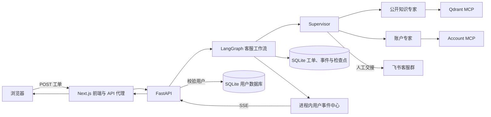

# Universal Decision Agent

面向客服场景的多智能体决策与工单工作流。后端使用 LangGraph 编排客服工作流，通过 MCP 工具查询公开知识和用户账户信息、向用户澄清问题，或将摘要交给飞书人工客服；前端通过工单 API 提交消息，并通过 SSE 接收工单状态和客服回复。

## 当前能力

- **公开知识查询**：Supervisor 将政策和帮助文档问题交给 `public_knowledge` 专家，通过 Qdrant 检索并核对候选答案。
- **账户信息查询**：`account` 专家通过 MCP 查询现有用户资料和预约信息。
- **澄清与人工交接**：信息不足时可请求用户补充；需要人工处理时，将工单摘要发送到配置的飞书群。
- **普通工单闭环**：前端提交消息后，后端创建工单并在后台运行工作流；前端用 SSE 接收受理、状态和 AI 回复事件。
- **工单持久化**：工单、事件和 LangGraph 检查点使用 SQLite 保存；事件写入失败时仍尝试向当前在线订阅者发送原事件。

Supervisor 负责决定是否调用专家或工具，并生成最终客服回复。当前工作流只读取账户和公开知识，不执行账户写入操作，也不查询历史工单来回答用户问题。

## 架构



## 普通工单流程

1. 浏览器将 `{ user_id, message }` 发送到 Next.js 的 `/api/tickets` 代理。
2. FastAPI 检查用户 ID 是否存在，创建工单并在后台启动 LangGraph 工作流，立即返回 `202 Accepted` 和工单编号。
3. 浏览器保持 SSE 连接，实时接收工单处理进度和回复。
4. 工作流结束后，前端展示 AI 回复及最终工单状态。

## 本地运行

### 1. 准备配置和依赖

使用项目 Python 虚拟环境安装依赖：

```powershell
.\.venv\python.exe -m pip install -r requirements.txt
Copy-Item .env.example .env
```

在 `.env` 中至少配置：

- `DEEPSEEK_API_KEY`：客服工作流模型密钥。
- `LARK_APP_ID`、`LARK_APP_SECRET`、`FEISHU_CHAT_ID`：飞书机器人及客服群配置。
- `QDRANT_URL`：Qdrant 服务地址；默认 `http://127.0.0.1:6333`。
- `COLLECTION_NAME` 及 embedding 配置：与已有 Qdrant collection 保持一致。

先启动并准备好 Qdrant collection 和用户数据库。当前 FastAPI lifespan 会连接飞书并初始化工作流，因此模型密钥、飞书配置和所需服务不可用时，服务不能完成启动。

### 2. 启动后端

```powershell
.\.venv\python.exe -m uvicorn agentic.app.fastapi_server:app --host 127.0.0.1 --port 8001
```

访问 <http://127.0.0.1:8001/health> 查看状态。工作流依赖对应的用户记录、模型、Qdrant 和飞书配置。

### 3. 启动前端

```powershell
Set-Location frontend
npm install
npm run dev
```

打开 <http://localhost:3000>。前端默认连接 `http://127.0.0.1:8001`；如需更改，在 `frontend/.env.local` 设置 `CUSTOMER_SUPPORT_API_URL` 后重启 Next.js。

## 主要目录

```text
agentic/
  agents/                Supervisor、账户和公开知识 Agent
  app/                   FastAPI 应用与 SSE 事件流
  capabilities/          飞书、MCP 客户端、中间件和工具
  data/tickets/          工单、事件和对话记录存储
  design/                Agent 与 MCP 架构资料
  evals/                 工作流和检索评估
  lifespan/              应用运行时资源初始化
  observability/         工作流追踪
  orchestration/         工单生命周期及 LangGraph 工作流
  config.yml             模型、工具和工作流配置
mcp_services/
  account/               账户查询 MCP 服务
  kb/                    知识库 MCP 服务
  memory/                记忆 MCP 服务
  qdrant/                Qdrant 检索 MCP 服务
frontend/                Next.js 客服聊天前端及 API 代理
data/
  core/                  核心用户数据
  external/              外部账户与预约数据
  models/                数据模型
notebooks/               数据库准备 notebook
scripts/                 数据迁移、开发和图表脚本
tests/                   工作流、API、工单存储和工具测试
```

## 当前限制

- 登录只记录用户 ID，不构成身份验证；后端通过用户记录存在性校验请求。正式部署前需要补上身份验证和授权。
- SSE 事件中心在进程内存中，服务重启或多进程部署时不提供跨进程广播。
- SSE 当前只推送实时事件，不支持断线后的事件回放；事件落库失败时，在线订阅者仍可能收到原事件，但该事件没有持久化序号，不能回放。
- 飞书消息桥接与客服工单 SSE 是不同通道；飞书人工回复目前不会自动回流到对应工单对话。
- `GET /tickets/{ticket_id}` 可查询单张工单状态，但前端当前实时交互以 SSE 为主。
